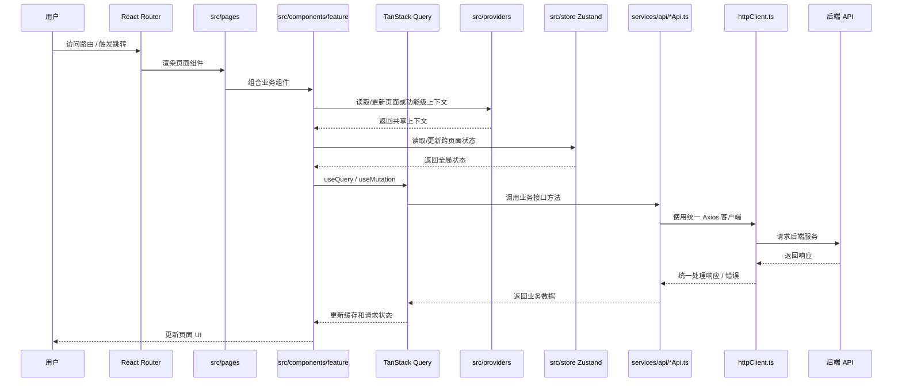
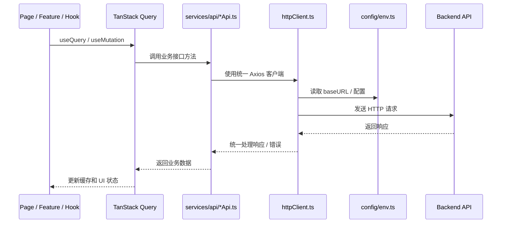
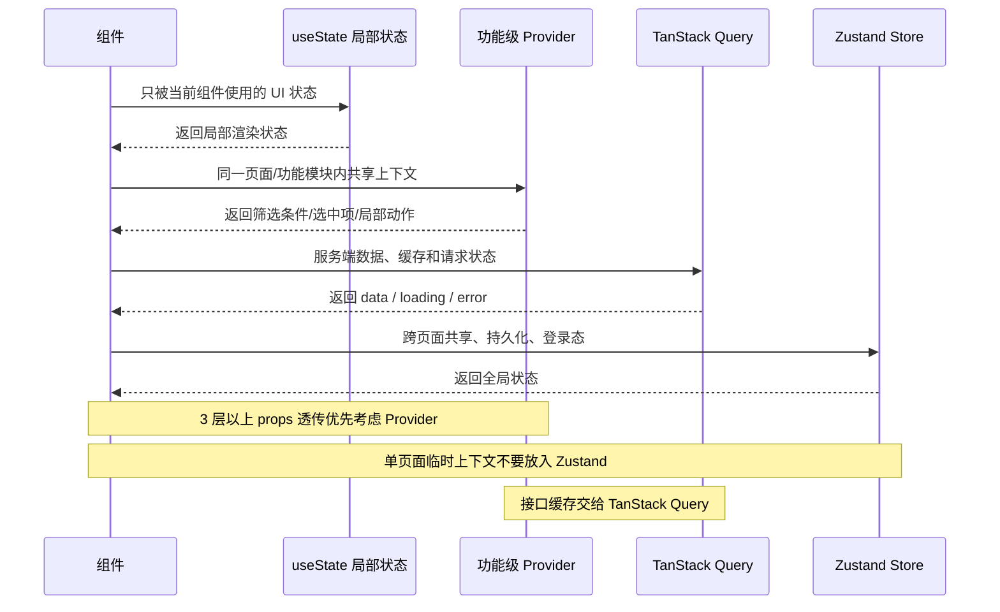
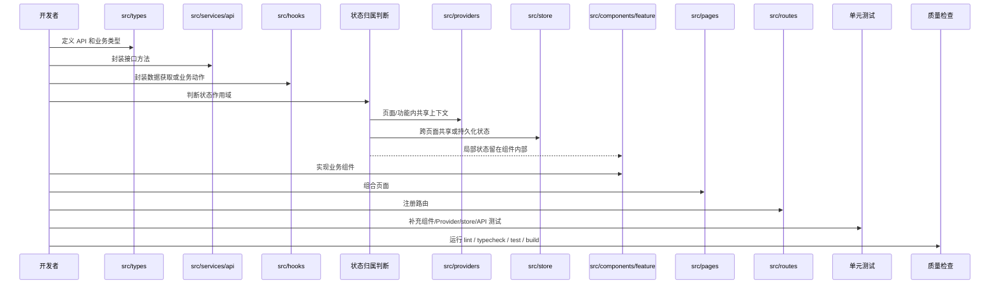

# React.js 架构流程图

本文档用 Mermaid 时序图说明 React SPA 模板的数据流向、HTTP 请求路径、状态边界和新功能开发流程。所有图尽量统一使用 `sequenceDiagram`，方便按调用顺序理解系统行为。

## 整体数据流

## HTTP 请求流

## 状态边界流

## 新功能开发流

## 阅读建议

- 开发新页面前阅读 `GUIDE.md`。
- 编写测试前阅读 `TEST.md`。
- 使用 AI Agent 前阅读 `AGENTS.md` / `CLAUDE.md`。

---

**最后更新**: 2026年5月27日
